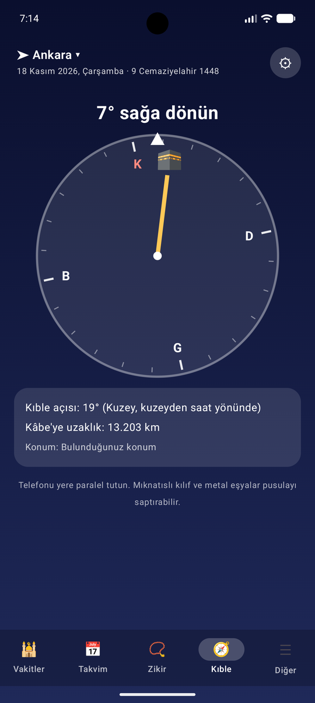
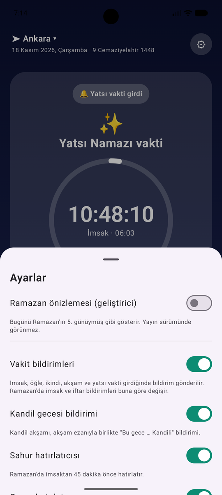
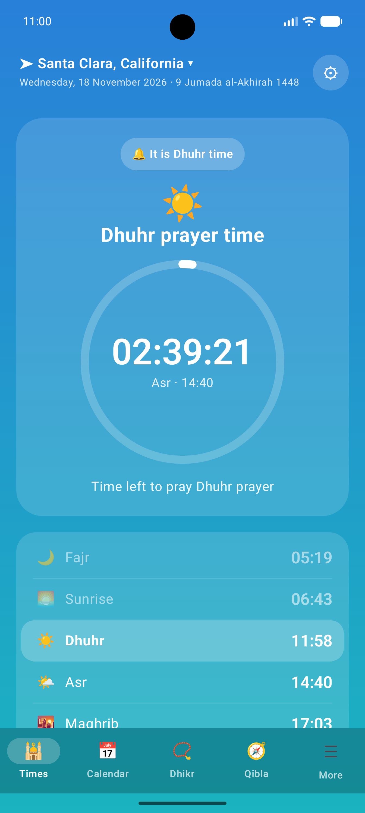
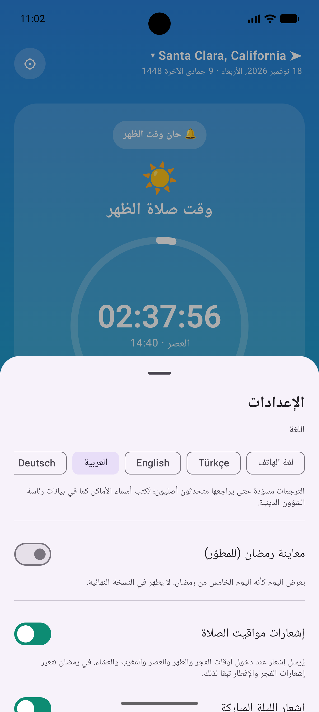
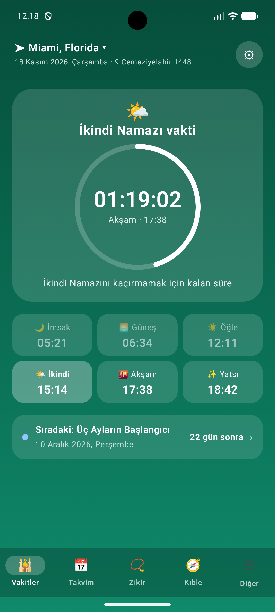
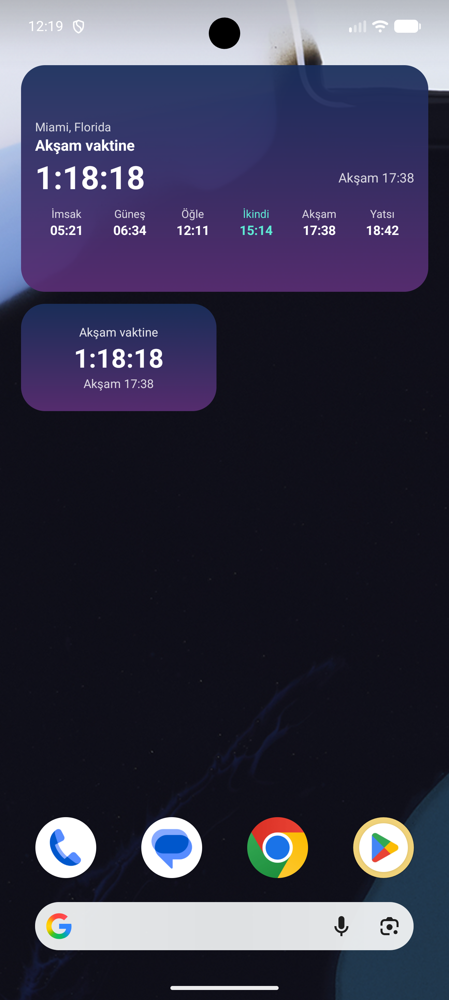

# Ezan Vakti — Android

Diyanet verisiyle çalışan namaz vakti uygulaması. Türkiye'de il ve ilçe, yurt dışında Diyanet'in vakit yayımladığı yaklaşık 200 ülkede eyalet ve şehir bazında vakitleri gösterir. Ekranda o anki vakit ve bir sonraki vakte kalan süre canlı olarak görünür. Uygulama 12 dilde kullanılabilir ve **Kotlin** ile **Jetpack Compose** ile yazıldı.

> Durum: deneme sürümü (v0.6.1). Henüz Play Store'da yayında değil.

<p align="center">
  
  
  
</p>
<p align="center">
  
  
  
</p>
<p align="center">
  
  
</p>
<p align="center">
  
  
</p>
<p align="center">
  
</p>

<sub>Ekran görüntüleri Android emülatöründen alındı. Kıble ekranındaki açı ve uzaklık, emülatörün varsayılan konumuna (ABD) göre hesaplanmıştır.</sub>

## Özellikler

**Vakitler**
- Konumdan il/ilçe (yurt dışında ülke, eyalet ve şehir) bulma ya da elle seçme; kayıtlı konumlar ve başka bir yere gidince konum güncelleme önerisi (seyahat modu)
- Vakitler, geri sayım ve bildirimler seçili konumun yerel saatine göre (yaz saati dahil)
- O anki vakit, sonraki vakte canlı geri sayım, vakte göre değişen arka plan
- Vakit bildirimleri, vakitten 10/15/30/45 dk önce hatırlatma
- Namaz vaktinde telefonu belirli süre "Rahatsız Etmeyin" moduna alma
- Kilit ekranında ve bildirim alanında canlı geri sayım
- Üç ana ekran widget'ı: büyük, küçük (2×1) ve şerit (4×1); koyu, şeffaf ya da uygulama temasıyla aynı arka plan (Ramazan'da iftar/sahura sayar)
- Kilit ekranı sayacı: yalnızca sıradaki vakit, sıradaki vakit + günün vakitleri ya da yalnızca Ramazan'da

**Takvim ve dini günler**
- Aylık takvim, hicri tarih, kandiller, bayramlar ve arefeler
- Ülkeye göre hicri takvim: Diyanet ya da Ümmülkurâ (Suudi Arabistan ve Körfez ülkelerinde varsayılan); hilal gözlemine göre ±2 gün düzeltme
- Ramazan kartı ve imsakiye, sahur hatırlatıcısı, iftar/imsak bildirimleri
- Cuma ve Kehf suresi hatırlatmaları; dini bayram ve kandil sabahları tebrik mesajı (Türkiye'nin resmî günleri yalnızca Türkiye'de)

**Görünüm**
- Arka plan temaları: vakte göre değişen, gece mavisi, zümrüt, mor, gün batımı, deniz, siyah (OLED)
- Vakitlerin dizilişi: alt alta liste, ikili ya da üçlü kutucuklar

**Diller**
- Türkçe, İngilizce, Arapça, Almanca, Fransızca, İspanyolca, Portekizce, Rusça, Endonezce, Urduca, Farsça, Bengalce
- Varsayılan telefonun dili; uygulama içinden değiştirilebilir. Arapça, Urduca ve Farsçada sağdan sola düzen

**Diğer**
- Zikirmatik: dokunarak ya da ses tuşlarıyla sayma, titreşim, hedefler, namaz tesbihatı modu
- Kıble pusulası: kıble açısı, Kâbe'ye uzaklık, manyetik sapma düzeltmesi, kalibrasyon uyarısı
- Kaza namazı ve orucu takibi
- Ayarlar'dan geri bildirim: en fazla 100 karakterlik mesaj, telefonun e-posta uygulamasıyla geliştiriciye gönderilir (sürüm, dil ve ülke bilgisi eklenir; uygulama kendisi hiçbir veri göndermez)

## Mimari

```
Diyanet verisi ──► GitHub Actions (haftada 2 kez) ──► GitHub Pages (statik JSON, Türkiye)
                                                          │
                     Android uygulaması ◄─────────────────┤
                                                          │
                     Diyanet verisinin aynası ────────────┘ (yurt dışı ve yedek)
```

- **Veri hattı:** Türkiye vakitleri ayrı bir depoda ([ezan-vakti-data](https://github.com/Doganmtl/ezan-vakti-data)) haftada iki kez 81 il ve tüm ilçeler için çekilir, doğrulanır ve statik JSON olarak yayınlanır. Bozuk ya da eksik veri gelirse yayındaki veri değiştirilmez. Uygulama kullanıcı başına giriş ya da anahtar gerektirmez.
- **Doğruluk:** Vakitler Diyanet'in resmî sitesiyle (namazvakitleri.diyanet.gov.tr) karşılaştırıldı; Ankara ve Albany (ABD) için 19–21 Kasım 2026 vakitleri hem veri deposunda hem aynada birebir aynı.
- **Kaynak zinciri:** `StaticDataProvider` (Türkiye) → (isteğe bağlı Awqat Salah API) → Diyanet aynası (tüm ülkeler). Yer kimlikleri tüm kaynaklarda Diyanet'inkilerdir.
- **Saat dilimi:** Her günün UTC farkı Diyanet verisinden okunur; telefon aynı dilimdeyse telefonun kuralları kullanılır.
- **Hicri takvim:** `model/HicriTakvim.kt` Diyanet'in dini günler listesini seçilen takvime (Diyanet ya da Android'in yerleşik Ümmülkurâ hesabı) taşır; günlerin kendisi her zaman Diyanet listesinden gelir.
- **Çeviri:** `i18n/` altında; anahtar Türkçe kaynak metindir, eksik bir çeviri Türkçe görünür. Uygulama içi dil seçimi etkinliğin yapılandırmasına uygulanır (sağdan sola diller dahil).
- **Çevrimdışı:** Son indirilen vakitler cihazda saklanır; bildirimler ve widget internet olmadan da çalışır.
- **Arka plan:** `AlarmManager` ile vakit anlarında çalışan bir tazeleyici widget'ı ve canlı sayacı yeniler, bildirim planını günde bir kayıtlı vakitlerle yeniden kurar.

## Teknolojiler

Kotlin · Jetpack Compose (Material 3) · AndroidViewModel + StateFlow · kotlinx.serialization · Fused Location Provider · Geocoder · AlarmManager · AppWidget (RemoteViews) · SensorManager (pusula) · java.time HijrahChronology

## Proje yapısı

```
app/src/main/java/com/example/ezanvakti/
├── data/      Veri kaynakları, önbellek, ayarlar
├── i18n/      Dil seçimi ve 11 dilin çeviri tabloları
├── model/     Vakit hesapları, hicri takvim, dini günler, kıble, tebrikler
├── notify/    Bildirim planlayıcı, sessize alma, canlı sayaç, tazeleyici
├── location/  Konumdan ülke, il/ilçe bulma
├── widget/    Ana ekran widget'ı
└── ui/        Compose ekranları
```

Sürüm notları ve geliştirme ayrıntıları: [docs/GELISTIRME-NOTLARI.md](docs/GELISTIRME-NOTLARI.md)

## Derleme

1. Projeyi Android Studio ile açın (Gradle eşitlemesi kendiliğinden yapılır).
2. Bir emülatör ya da USB hata ayıklaması açık bir telefon seçip **Run**'a basın.

Gereksinim: Android 8.0 (API 26) ve üstü.

## İçerik ilkesi

Uygulamadaki dini metinler yalnızca Diyanet İşleri Başkanlığı ve ona bağlı kaynaklardan alınır. Bu nedenle günün ayeti/hadisi gibi metin içerikleri, Diyanet'in resmî servisi üzerinden izinli olarak sağlanana kadar eklenmemiştir. Arayüz çevirileri taslaktır ve yayından önce ana dili o olan kişilerce gözden geçirilecektir.
