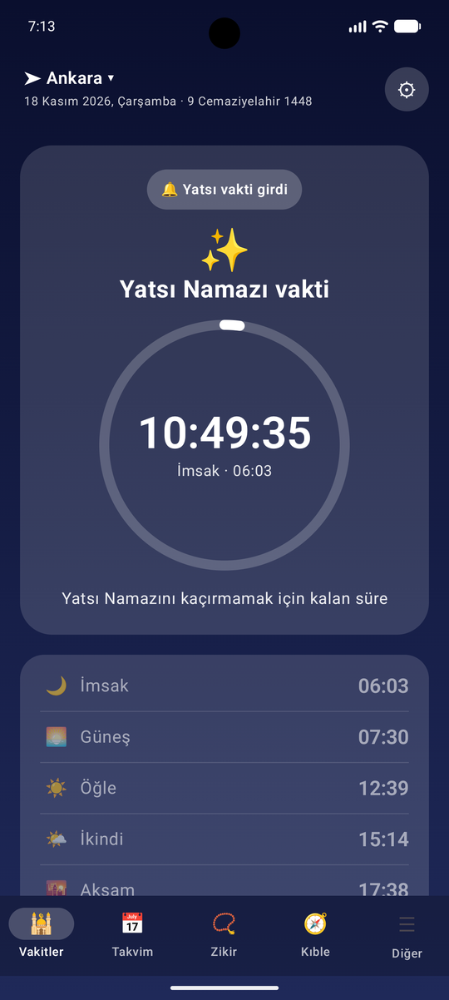
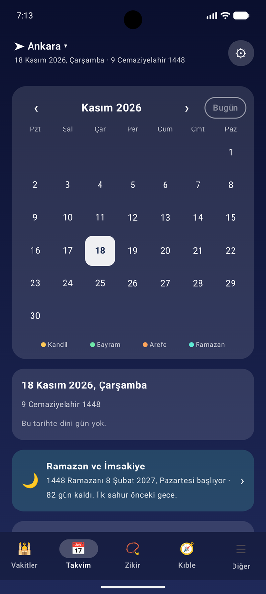
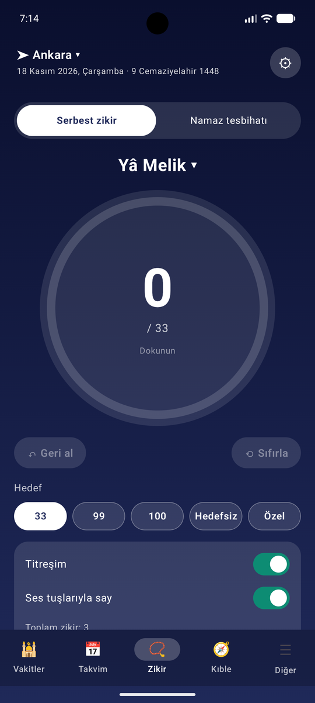
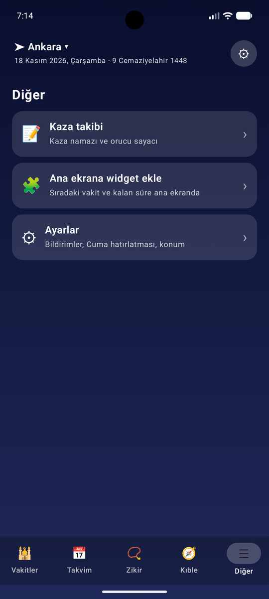
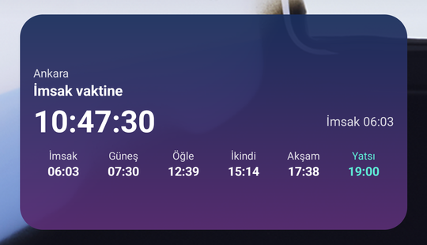

# Ezan Vakti — Android

Türkiye için namaz vakti uygulaması. Vakitler il ve ilçe bazında **Diyanet İşleri Başkanlığı** verisinden gelir; ekranda o anki vakit ve bir sonraki vakte kalan süre canlı olarak görünür. Uygulama **Kotlin** ve **Jetpack Compose** ile yazıldı.

> Durum: deneme sürümü (v0.4.0). Henüz Play Store'da yayında değil.

<p align="center">
  
  
  
</p>
<p align="center">
  
  
  
</p>
<p align="center">
  
</p>

<sub>Ekran görüntüleri Android emülatöründen alındı. Kıble ekranındaki açı ve uzaklık, emülatörün varsayılan konumuna (ABD) göre hesaplanmıştır.</sub>

## Özellikler

**Vakitler**
- Konumdan il/ilçe bulma ya da elle seçme; kayıtlı konumlar ve başka ile gidince konum güncelleme önerisi (seyahat modu)
- O anki vakit, sonraki vakte canlı geri sayım, vakte göre değişen arka plan
- Vakit bildirimleri, vakitten 10/15/30/45 dk önce hatırlatma
- Namaz vaktinde telefonu belirli süre "Rahatsız Etmeyin" moduna alma
- Kilit ekranında ve bildirim alanında canlı geri sayım
- Ana ekran widget'ı (Ramazan'da iftar/sahura sayar)

**Takvim ve dini günler**
- Aylık takvim, hicri tarih, kandiller, bayramlar ve arefeler
- Ramazan kartı ve imsakiye, sahur hatırlatıcısı, iftar/imsak bildirimleri
- Cuma ve Kehf suresi hatırlatmaları; resmî/dini bayram ve kandil sabahları tebrik mesajı

**Diğer**
- Zikirmatik: dokunarak ya da ses tuşlarıyla sayma, titreşim, hedefler, namaz tesbihatı modu
- Kıble pusulası: kıble açısı, Kâbe'ye uzaklık, manyetik sapma düzeltmesi, kalibrasyon uyarısı
- Kaza namazı ve orucu takibi

## Mimari

```
Diyanet verisi ──► GitHub Actions (haftada 2 kez) ──► GitHub Pages (statik JSON)
                                                          │
                     Android uygulaması ◄─────────────────┘
                     (yedek: Diyanet verisinin aynası)
```

- **Veri hattı:** Vakitler ayrı bir depoda ([ezan-vakti-data](https://github.com/Doganmtl/ezan-vakti-data)) haftada iki kez 81 il ve tüm ilçeler için çekilir, doğrulanır ve statik JSON olarak yayınlanır. Bozuk ya da eksik veri gelirse yayındaki veri değiştirilmez. Uygulama kullanıcı başına giriş ya da anahtar gerektirmez.
- **Kaynak zinciri:** `StaticDataProvider` → (isteğe bağlı Awqat Salah API) → Diyanet aynası. İl/ilçe kimlikleri tüm kaynaklarda aynıdır.
- **Çevrimdışı:** Son indirilen vakitler cihazda saklanır; bildirimler ve widget internet olmadan da çalışır.
- **Arka plan:** `AlarmManager` ile vakit anlarında çalışan bir tazeleyici widget'ı ve canlı sayacı yeniler, bildirim planını günde bir kayıtlı vakitlerle yeniden kurar.

## Teknolojiler

Kotlin · Jetpack Compose (Material 3) · AndroidViewModel + StateFlow · kotlinx.serialization · Fused Location Provider · AlarmManager · AppWidget (RemoteViews) · SensorManager (pusula)

## Proje yapısı

```
app/src/main/java/com/example/ezanvakti/
├── data/      Veri kaynakları, önbellek, ayarlar
├── model/     Vakit hesapları, dini günler, kıble, tebrikler
├── notify/    Bildirim planlayıcı, sessize alma, canlı sayaç, tazeleyici
├── location/  Konumdan il/ilçe bulma
├── widget/    Ana ekran widget'ı
└── ui/        Compose ekranları
```

Sürüm notları ve geliştirme ayrıntıları: [docs/GELISTIRME-NOTLARI.md](docs/GELISTIRME-NOTLARI.md)

## Derleme

1. Projeyi Android Studio ile açın (Gradle eşitlemesi kendiliğinden yapılır).
2. Bir emülatör ya da USB hata ayıklaması açık bir telefon seçip **Run**'a basın.

Gereksinim: Android 8.0 (API 26) ve üstü.

## İçerik ilkesi

Uygulamadaki dini metinler yalnızca Diyanet İşleri Başkanlığı ve ona bağlı kaynaklardan alınır. Bu nedenle günün ayeti/hadisi gibi metin içerikleri, Diyanet'in resmî servisi üzerinden izinli olarak sağlanana kadar eklenmemiştir.
